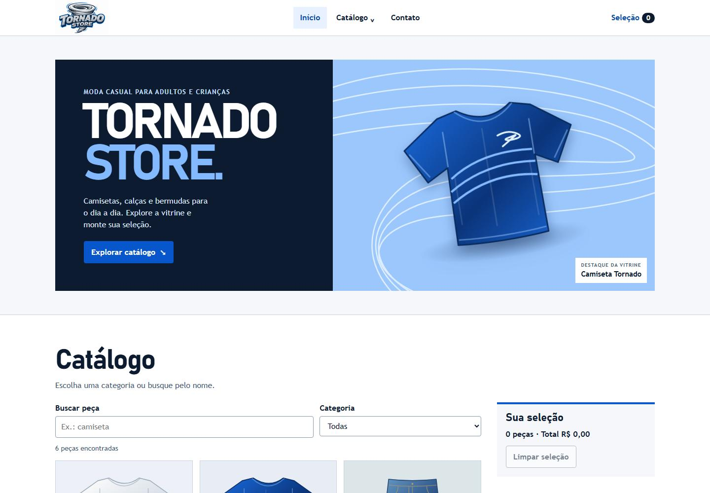
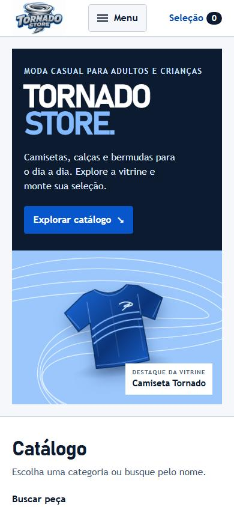

# Tornado Store

A Tornado Store é uma vitrine de roupas masculinas casuais e infantis.
O site permite buscar e filtrar peças, montar uma seleção e conferir o total na hora.
É o Projeto Integrador da disciplina de Desenvolvimento Front-end para Web.

## Tecnologias

HTML5, CSS3 e JavaScript puro. As ilustrações são SVG e a vinheta usa WebM e WAV.

## Capturas de tela

| Computador | Celular |
| --- | --- |
|  |  |

## Estrutura

```text
.
├── index.html
├── css/
│   ├── reset.css
│   └── style.css
├── js/
│   └── script.js
└── assets/
    ├── audio/     # Vinheta WebM e WAV
    └── images/    # Logo, ilustrações e capturas
```

## Como executar

1. Clone o repositório ou baixe uma cópia de seus arquivos.
2. Abra `index.html` no navegador. Também funciona pelo Live Server.
3. Busque uma peça, filtre por categoria e selecione os produtos. O resumo mostra a quantidade e o total.
4. Use dados fictícios para testar o formulário. O envio é simulado no navegador.

## Mapa dos requisitos

| Requisito | Onde conferir |
| --- | --- |
| 2.1 · Tema, visibilidade e nome | Repositório público `projeto-integrador-frontend-ciro`, tema Tornado Store |
| 2.1 · Pastas em minúsculas e caminhos relativos | Árvore acima, links e mídias em `index.html`, imagens em `criarCard` |
| 2.1 · Commits, branches e PRs | Abas Commits e Pull Requests do GitHub. A versão entregue deve estar na `main` |
| 2.1 · README | Este arquivo |
| 2.2 · DOCTYPE, idioma, metadados e título | `index.html`, início do arquivo |
| 2.2 · Conteúdo básico | `index.html`, `#inicio` e `#sobre`, com título, descrição, três itens de lista, tabela com duas peças, link externo seguro e imagens com alt |
| 2.2 · Semântica | `index.html`, `header`, `nav`, um `main`, seções com título, `aside` e `footer` |
| 2.2 · Formulário | `index.html`, `#form-contato`, com seis campos, labels associados, fieldset, legend, required e número de pedido com min 1 |
| 2.2 · Mídia | `index.html`, `.som`, áudio instrumental sem fala em WebM e WAV e comentário de preload |
| 2.2 · SVG responsivo | `index.html`, SVG `.vento` com viewBox. As peças usadas no catálogo também são SVG |
| 2.3 · Reset, estilo e box model | `css/reset.css`, regra global de box-sizing. `css/style.css`, `.botao`, `.produto` e `fieldset` com padding, border e margin nos elementos da página |
| 2.3 · Variáveis, classes, ID e combinadores | `css/style.css`, `:root`, `.limite`, `.botao`, `.faixa`, `#retorno-contato` e `.menu li > a` |
| 2.3 · Estados dos links | `css/style.css`, regras `:link`, `:visited`, `:hover` e `:active`, nessa ordem |
| 2.3 · Lista, tabela e tipografia | `css/style.css`, `.linha-produtos`, `table`, `th, td`. Fontes em rem com justificativa no primeiro comentário |
| 2.3 · Menu | `css/style.css`, `.barra` e `.menu` em Flexbox, `.cabecalho` sticky, `.menu .ativo`, dropdown por hover e foco, e botão hambúrguer |
| 2.3 · Grid, pseudo-classe e responsividade | `css/style.css`, `.grade`, `.produto:nth-child`, hover com transform e media queries |
| 2.4 · Dados e planejamento | `js/script.js`, comentário inicial e array `produtos` com seis objetos |
| 2.4 · Lógica | `mostrarProdutos` (if/else if/else), `nomeCategoria` (switch), `atualizarSelecao` (for...of acumula linhas e while limpa a lista) |
| 2.4 · Funções, escopo e coerção | `filtrarProdutos` processa e retorna os itens usando a constante local `termo`. `nomeCategoria` devolve o rótulo. A leitura de data-produto usa `Number()` |
| 2.4 · Arrays e DOM | `filtrarProdutos` usa filter, `mostrarProdutos` usa map, `atualizarSelecao` usa reduce. `criarElemento` usa createElement, textContent e classes CSS |
| 2.4 · Eventos e feedback | `js/script.js`, eventos de input e change dos filtros, clique delegado em `listaProdutos` e botões nativos com aria-pressed e aria-expanded. `#resumo` usa aria-live. O retorno do formulário usa textContent |
| 2.4 · Script e console | `index.html`, último item antes de fechar body, script único com defer. Na revisão, confira Console e Network durante o uso |
| 3 · Execução, capturas e autoria | Seções deste README |

## Autor

- Nome: Ciro Junior
- RGM: preencher na revisão final
- Curso: preencher na revisão final
